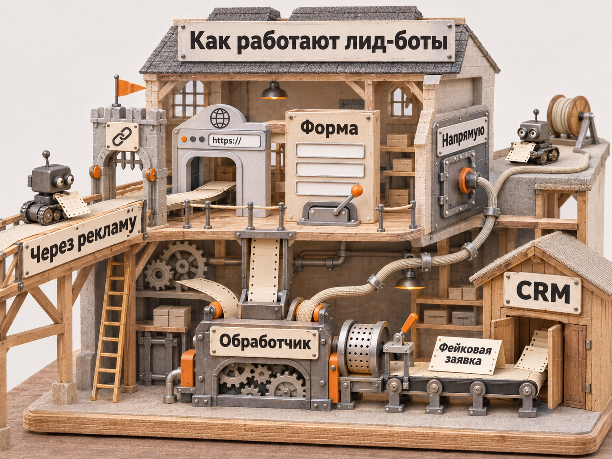
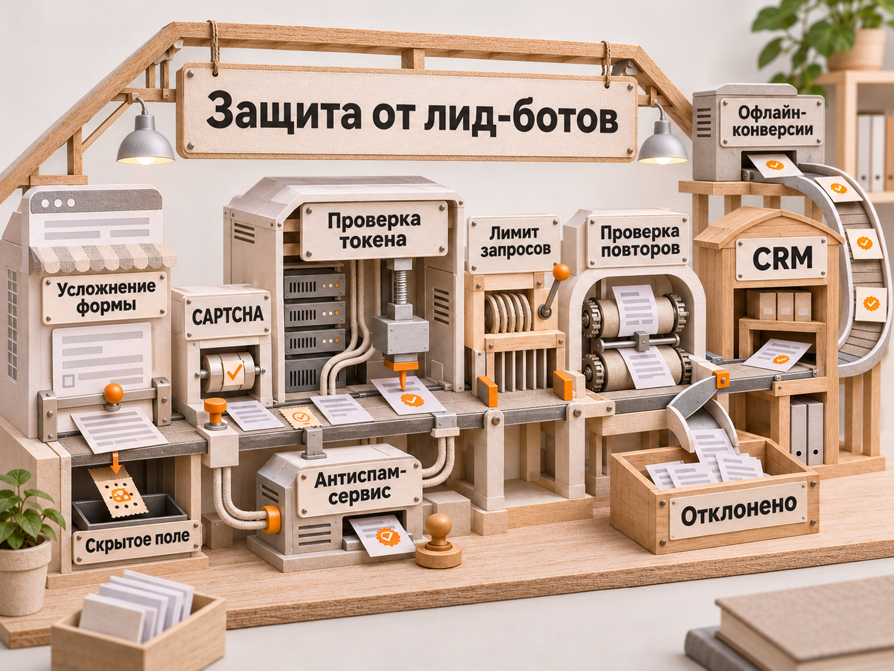

<SEO-META>
article_type: STANDARD
seo_title: Лид-боты: как выявить фейковые заявки и защитить рекламу
meta_description: Как работают лид-боты, чем опасны фейковые заявки, как проверить их в Яндекс Директе, Метрике и CRM и защитить формы сайта от спама.
slug: lid-boty
primary_query: лид-боты
canonical: https://naklikay.ru/blog/lid-boty/
date_published: 2026-11-13
date_modified: 2026-11-13
</SEO-META>

<ARTICLE-BODY>
# Лид-боты: как работают, чем опасны и как от них защититься

**Лид-боты** - программы, которые автоматически отправляют заявки через формы на сайте или прямо в серверный обработчик. Из-за них в CRM появляются обращения с вымышленными или чужими контактами, менеджеры тратят время на проверку, а статистика конверсий может перестать отражать реальные запросы клиентов. Если такие обращения связаны с оплачиваемой рекламой и не отфильтрованы антифродом, они способны исказить оценку и оптимизацию кампаний.

Однако фейковая заявка не означает, что за неё заплатили в Яндекс Директе. Спам может приходить напрямую на сайт, без рекламного клика. Для диагностики нужно сопоставить заявки, визиты, рекламные данные и результат обработки контакта.

## Что такое лид-боты и зачем они отправляют заявки

Термином «лид-боты» в этой статье называются автоматизированные инструменты, которые создают фиктивные обращения. Их не следует путать с обычными чат-ботами и формами-лидогенераторами: те помогают реальным пользователям связаться с компанией.

У автоматических отправок бывают разные цели. Одни программы массово рассылают спам по доступным формам. Другие пытаются перегрузить обработку заявок, заполнить CRM бессмысленными контактами или имитировать целевые действия. Наличие атаки само по себе не доказывает, кто её организовал и была ли она направлена против конкретной рекламной кампании.

Подозрительное обращение может содержать правдоподобные имя и телефон. Иногда номер существует, но его владелец утверждает, что заявку не отправлял. Поэтому проверять нужно не только формат заполненных полей, но и источник заявки, историю её создания и результат контакта с человеком.

## Как лид-боты оставляют фейковые заявки

### Через рекламу и обычную страницу сайта

Автоматизированный браузер или управляемый скриптом пользователь может перейти по объявлению, открыть страницу, заполнить поля и нажать «Отправить». В аналитике при этом потенциально появятся визит и событие отправки формы. Но факт визита и достижения цели ещё не подтверждает заинтересованность человека в покупке.

Если рекламная система определит переход или конверсию как недействительные, она может исключить их из своей статистики. При этом запись о посещении или заявке способна оставаться в Метрике и CRM. Поэтому показатели разных систем не всегда совпадают.

### Напрямую в обработчик формы, без рекламного клика

Форма на сайте передаёт заполненные поля серверу. Если сервер принимает такие запросы без достаточной проверки, программа может направить данные прямо в этот обработчик. В таком случае браузерное посещение страницы и рекламный клик вообще не нужны.

Результат для бизнеса выглядит одинаково: новая карточка в CRM, письмо или уведомление менеджеру. Но для расследования это принципиально разные ситуации. Вторая не свидетельствует о скликивании рекламных объявлений.

Иллюстрация № 1
Два разных маршрута отправки фейковой заявки: через рекламу и напрямую в серверный обработчик.

### С использованием чужих контактов и повторяющихся шаблонов

Автоматическая отправка не обязательно выглядит как набор случайных букв. В обращениях могут использоваться настоящие телефонные номера, распространённые имена, похожие комментарии и меняющиеся IP-адреса. Отдельные признаки легко совпадают с поведением реальных клиентов, поэтому искать нужно сочетание аномалий.

## Чем лид-боты опасны для рекламы и бизнеса

Первый ущерб - работа отдела продаж. Менеджер звонит по неверному номеру, проверяет дубль, уточняет, кто оставил обращение, и откладывает обработку настоящих клиентов. При массовом спаме растёт нагрузка на CRM, уведомления и интеграции.

Второй риск - неправильные выводы об эффективности рекламы. Кампания может показывать привлекательный CPL по событиям «Отправка формы», хотя существенная часть таких обращений не приводит к предметному разговору. Если рекламная стратегия получает некорректные сигналы о конверсиях, не распознанных антифродом, это может ухудшать оптимизацию.

### Пример: как меняется стоимость обращения

Допустим, за период реклама потратила **30 000 ₽**, а в CRM попало **30 заявок**, все они атрибутированы к рассматриваемой рекламе. При проверке установлено, что **10 заявок фиктивные**, остальные **20 - реальные обращения**. Для примера считаем, что 30 000 ₽ - окончательные расходы после возможных корректировок антифрода.

| Показатель | Значение |
|---|---:|
| Рекламные расходы | 30 000 ₽ |
| Все заявки | 30 |
| Подтверждённые фейковые заявки | 10 |
| Реальные обращения | 20 |
| CPL по всем заявкам | 1000 ₽ |
| Стоимость реального обращения | 1500 ₽ |

Расчёт: 30 000 / 30 = 1000 ₽, а 30 000 / 20 = 1500 ₽. Каждая третья заявка оказалась фиктивной, и реальная стоимость обращения выше на 50%. Это **условный пример**, не статистика конкретного проекта и не среднерыночная доля ботов. Реальный контакт ещё не равен квалифицированному лиду или продаже.

Иллюстрация № 2
Механическая сортировка показывает разницу между формальным CPL и стоимостью реального обращения.

Если спам пришёл напрямую на сайт без участия рекламы, включать его в количество оплаченных рекламных лидов при расчёте CPL нельзя. Здесь требуется отдельно исправлять аналитику и защищать сайт.

## Как отличить лид-бота от нецелевого клиента

Не всякая плохая заявка создана ботом. Реальный человек мог ошибиться цифрой, забыть об обращении, не взять трубку, отказаться из-за цены или не подойти по условиям услуги. Для проверки нужны несколько независимых признаков.

| Что обнаружено | Что это может означать | Как проверить |
|---|---|---|
| Серия одинаковых комментариев за короткое время | Автоматизация или шаблонный спам | Сравнить время, текст, данные отправки и серверные запросы |
| Телефон не существует либо владелец отрицает заявку | Недостоверный контакт, ошибка или злоупотребление | Проверить исходную запись и историю связи |
| Заявки поступают, а визитов в Метрике почти нет | Прямые запросы к форме либо сбой аналитики | Сопоставить журналы сервера, загрузку счётчика и события формы |
| Много обращений из одной технической среды | Возможная массовая отправка | Проверить IP и частоту запросов, учитывая прокси и общие сети |
| В Метрике есть визит и отправка формы, но клиент не подтверждён | Бот, случайный или нецелевой посетитель | Проверить Вебвизор, источник и результат обработки в CRM |
| Только низкое время на сайте или высокий показатель роботов | Подозрительный трафик, но не доказательство фальшивой заявки | Изучить другие сигналы и сравнить с рекламными расходами |

Практическое правило: присваивать статус «фейковая» следует после проверки, а не автоматически по одному признаку. Для сомнительных случаев удобно иметь отдельный статус «требует проверки».

## Как выявить лид-ботов в Яндекс Директе, Метрике и CRM

Проверку лучше вести от конкретной заявки к источнику, а не пытаться определить бота по одной диаграмме посещаемости.

### Шаг 1. Проверить «Недействительный трафик» в Яндекс Директе

Откройте **Статистика: Библиотека отчётов, «Недействительный трафик»**. Сравните период подозрительных заявок с числом отфильтрованных кликов. По документации Яндекса недействительные конверсии в этом отчёте показываются для стратегий с оплатой за конверсии; недействительные клики доступны для всех типов кампаний.

Антифрод исключает признанные недействительными события из отчётов Директа, а расходы за такой трафик не списываются или возвращаются. Поэтому подозрительные записи в CRM и Вебвизоре сами по себе не означают потерю рекламных денег.

### Шаг 2. Найти проблемные источники внутри РСЯ

В **Библиотеке отчётов: Оптимизация размещения, «Площадки»** посмотрите расход, клики, конверсии и CPA по сайтам и приложениям. Сопоставьте эти данные с подтверждёнными и отклонёнными заявками из CRM.

Отключать площадку только потому, что её название кажется подозрительным, не нужно. Основанием должны быть достаточный объём данных и реальные проблемы с результатом. Если часть заявок появилась без рекламных переходов, список площадок РСЯ эту проблему не устранит.

Подробный разбор трафика есть в материале [«Боты в РСЯ: как определить и что с ними делать»](https://naklikay.ru/blog/boty-v-rsya/).

### Шаг 3. Проверить Яндекс Метрику и Вебвизор

В Метрике откройте **Отчёты: Мониторинг, «Роботы»**. Этот отчёт показывает обнаруженную активность роботов, но не служит готовым списком фейковых заявок. Дополнительно проверьте источники визитов, страницы входа, достижение цели формы и доступные записи Вебвизора за нужный период.

Учитывайте два ограничения. Во-первых, Вебвизор может содержать посещения, которые антифрод уже исключил из статистики Директа. Во-вторых, при прямой отправке в обработчик формы полноценного браузерного визита и записи Вебвизора может не быть. Отсутствие записи также возможно из-за настроек аналитики, блокировщиков и технических ошибок.

### Шаг 4. Сопоставить заявки с CRM

Для каждой подозрительной записи соберите в одну таблицу:

- время создания заявки и её идентификатор в CRM;
- страницу и форму, через которую она должна была поступить;
- «ClientID» Метрики, если он сохранился;
- «yclid» и UTM-метки, если они передавались;
- рекламную кампанию и площадку, если источник надёжно определён;
- статус дозвона и итог квалификации.

«ClientID» помогает связать визит и заявку, но его отсутствие не доказывает прямой запрос бота: идентификатор мог не записаться по техническим причинам. Проверьте, работает ли его сохранение на обычных тестовых обращениях.

Иллюстрация № 3
Одна заявка проходит последовательную проверку источника, связи визита, серверной отправки и результата контакта.

### Шаг 5. Посмотреть серверные журналы отправки форм

Если заявки продолжают поступать при остановленной рекламе или без соответствующих визитов, попросите разработчика проверить **POST-запросы к обработчику формы**, частоту запросов, результат серверной проверки, источник интеграции и ошибки. Нужны именно данные по созданию заявок, а не только журналы загрузки страниц.

Повторяющиеся запросы с одинаковыми параметрами, массовые отправки в течение секунд и обход клиентской проверки повышают вероятность автоматизации. При этом IP-адрес, User-Agent или отсутствие Referrer по отдельности ненадёжны. Собирайте минимально необходимую техническую информацию с учётом правил обработки персональных данных.

## Как защитить формы сайта от лид-ботов

Защита должна работать **на сервере**, там, где принимается решение о создании заявки и передаче её в CRM. Проверка только в интерфейсе страницы не остановит программу, отправляющую запрос прямо в обработчик.

### CAPTCHA с серверной проверкой

Для сайта можно использовать Yandex SmartCaptcha или аналогичный сервис. Важна не просто картинка или виджет на форме, а проверка одноразового токена на сервере перед принятием заявки. У SmartCaptcha серверная проверка предусмотрена документацией: токен ограничен по времени и проверяется через специальный метод сервиса.

Если виджет подключён, но сервер никак не проверяет результат, защита остаётся неполной. Учитывайте и доступность формы для реальных посетителей: чрезмерно сложные проверки могут мешать конверсии.

### Ограничение частоты и проверка дублей

На уровне сервера установите разумные лимиты отправок, например по сочетанию IP, технического идентификатора сессии и самой формы. Конкретные пороги выбирают по реальному трафику, а не одинаковыми для всех сайтов. Повторяющиеся одинаковые контакты и сообщения можно отправлять в отдельную очередь проверки.

Избегайте безусловной блокировки всех запросов с одного IP: за одним адресом могут находиться сотрудники офиса, мобильные пользователи или общая сеть провайдера.

### Проверка полей и контроль обработки

Проверяйте обязательные поля, разумную длину сообщений, формат контактов и корректность данных на сервере. Скрытое антиспам-поле может отсечь простые сценарии автоматизации, но не является самостоятельной защитой. При заметной нагрузке полезно подключать WAF или специализированную антибот-фильтрацию.

Иллюстрация № 4
Многоуровневая защита формы и передача проверенных данных из CRM в офлайн-конверсии.

Сохраняйте причину отклонения заявки и аккуратно настраивайте интеграции. Отклонённый сервером запрос не должен одновременно создавать успешную заявку в CRM и отправлять рекламную цель «Форма отправлена».

## Как защитить обучение Яндекс Директа от фейковых конверсий

Для рекламных отчётов полезно разделить три события: отправка формы, подтверждённый контакт и квалифицированный лид. Первое удобно для анализа поведения на сайте, второе показывает существование обращения, третье ближе к коммерческой ценности.

После проверки CRM можно передавать квалифицированные лиды в Метрику как офлайн-конверсии или данные из CRM. Для точной связки Яндекс рекомендует сохранять «ClientID» при создании сделки. Проверяйте, что данные действительно привязались к визитам, прежде чем использовать такую цель в оптимизации.

Переключать автостратегию на редкую цель без оценки объёма данных не следует: недостаточное число конверсий может ухудшить обучение. Сначала посчитайте количество подтверждённых лидов, проверьте стабильность передачи и только затем выбирайте целевое событие стратегии.

Подробно об этом: [«Офлайн-конверсии в Яндекс Директе»](https://naklikay.ru/blog/offline-conversions-yandex-direct/) и [«Квалификация лидов в продажах»](https://naklikay.ru/blog/kvalifikaciya-lidov-v-prodazhah/).

## Что делать, если фейковые заявки уже идут

1. **Сохраните доказательства.** Выгрузите период, ID заявок, время, статусы CRM, сопутствующие рекламные отчёты и доступные технические журналы. Не публикуйте персональные данные клиентов.
2. **Разделите источники.** Определите, были ли оплаченные переходы, визиты без рекламы или прямые запросы к серверу. Не приписывайте все заявки одной площадке автоматически.
3. **Закройте уязвимость формы.** Проверьте серверную валидацию, CAPTCHA, лимиты и передачу заявки в CRM. Перед включением жёсткой блокировки протестируйте реальное обращение.
4. **Проверьте аналитику.** Убедитесь, что отклонённые запросы не создают конверсии и не искажают внутренние отчёты. Сохраните исходные данные, прежде чем исправлять классификацию.
5. **Оцените рекламу после очистки данных.** Смотрите подтверждённые обращения и квалифицированные лиды, а не только заполнения формы.
6. **Обратитесь в поддержку Директа, если подозреваете именно рекламный фрод.** Передайте номер объявления, даты, номер счётчика Метрики, ссылки на отчёты и описание аномалий.

## Можно ли вернуть деньги за фейковые заявки в Яндекс Директе

За трафик, который Яндекс признаёт недействительным, расходы обычно не списываются или автоматически возвращаются на баланс рекламного счёта. Если подозрения остаются, можно обратиться в поддержку с данными для проверки.

Но **сам факт фейковой заявки не означает право на возврат рекламного бюджета**. Если форма была отправлена напрямую, оплаченного клика могло не быть. Если обращение оставил реальный, но неподходящий по условиям пользователь, это тоже не обязательно фрод. По актуальной справке Яндекса проверка конверсий на фрод возможна за последние 30 дней, поэтому обращаться с конкретными подозрениями лучше без промедления.

При расследовании полезно отдельно рассчитать расходы по прошедшим антифрод кликам, число заявок в CRM, долю подтверждённых контактов и стоимость квалифицированного лида. Только эта связка показывает, где действительно теряются деньги: в рекламном трафике, обработке форм или работе отдела продаж.
</ARTICLE-BODY>
